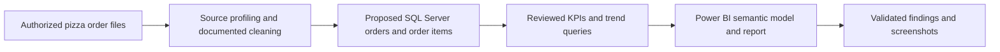

# Analytics pipeline — Pizza Sales

The flow below is the **intended project architecture**, not evidence that the original datasets, model or report has been executed.

**Key contracts to verify:** order vs line-item grain, identifier uniqueness, datetime timezone, discounts, taxes, currency and negative amounts. See [SQL contract](../sql/01_schema_contract.sql), [metrics](METRICS.md), and [data-quality checklist](DATA_QUALITY.md).
